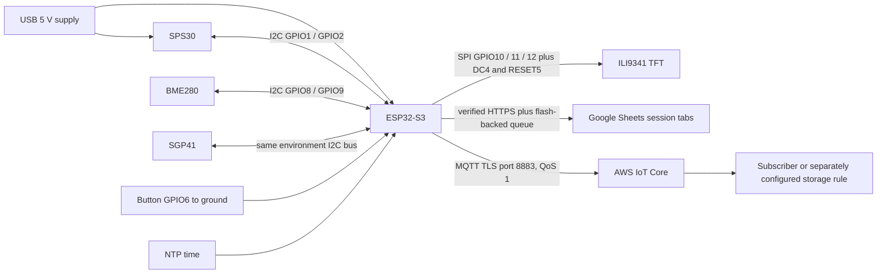

Aervia hardware guide

Current prototype, firmware and integration reference. Updated 10 October 2026.

This folder contains the ESP32-S3 hardware build used for live sensor telemetry, an eight-page TFT interface, direct Google Sheets logging and AWS IoT Core publishing. Measurements come from the connected sensors. Unavailable quantities are explicitly missing; no synthetic measurements replace them. The device operates independently of a laptop after USB provisioning, provided it has USB power and an internet-connected 2.4 GHz Wi-Fi network.

1. Folder contents

| Path | Purpose |
| --- | --- |
| `firmware/AerviaFieldLogger/` | Main Arduino sketch and sensor, UI, history, Sheets and AWS modules |
| `config/LocalConfig.example.h` | Spreadsheet ID template; copy as the ignored sketch-local `LocalConfig.h` |
| `config/wifi.example.json` | Wi-Fi provisioning template; actual credentials stay outside Git |
| `config/aws-device-policy.example.json` | Publish-only IoT certificate policy; substitute the AWS account ID |
| `config/validated-library-versions.json` | Library versions used for the verified firmware |
| `tools/provision_field_logger.py` | Provision Wi-Fi and Google service-account credentials over USB |
| `tools/provision_aervia_aws.py` | Validate a certificate/key pair and provision AWS configuration over USB |
| `vendor/MQTT/` | MQTT 2.5.2 source and its original license |

The public firmware defaults to an empty spreadsheet ID instead of publishing a personal spreadsheet destination. The installed prototype has its original destination configured. This publication changes no wiring and does not reflash the physical device.

2. Components and functions

| Component | Role and measured outputs |
| --- | --- |
| Edgehax S3-PRO, ESP32-S3 N16R8 | Controller, Wi-Fi, display, timestamping and cloud workers; 16 MB flash and 8 MB OPI PSRAM hardware variant |
| Sensirion SPS30 | PM1, PM2.5, PM4 and PM10 mass concentration; five cumulative particle-number ranges; typical particle size |
| Bosch BME280 breakout | Temperature, relative humidity and barometric pressure |
| Sensirion SGP41 breakout | Raw VOC/NOx signals and relative VOC/NOx indices computed by Sensirion algorithms |
| 2.8-inch 240 × 320 SPI TFT, ILI9341 | Landscape 320 × 240 local dashboard and trends |
| Normally-open momentary button | Page switching and return to home |
| USB cable and regulated power bank or laptop USB | Power; laptop also provides firmware upload and optional diagnostics |
| Sensor harness, insulated jumper joins and retention | Electrical connections and strain relief |

The TFT board has touch-labelled pins, but touch is not enabled. No GPS, microSD or battery-voltage measurement is connected in this build. Wi-Fi RSSI and firmware diagnostics are available without extra components. Wind, PBLH, CO2 concentration and pollutant-specific gas concentrations are not measured by this hardware. SGP41's NOx index is not an NO2 concentration in ppb or ppm.

3. Hardware and firmware architecture



Two independent I2C buses run at 100 kHz. The measurement/display loop runs on the normal Arduino core; network operations use separate workers pinned to core 0. The UI framebuffer is allocated in PSRAM so TLS has sufficient internal memory. Network work is never invoked synchronously from the sensor acquisition loop. This separation reduces blocking; it is not a hard real-time guarantee.

4. Exact wiring

Disconnect all USB power before connecting or reseating wires. Read the board's GPIO labels, not physical header position numbers. All modules share ground. A free board `G` pin can connect directly to the TFT; a separate ground splitter is not required when sufficient ground pins are available.

| Module signal | ESP32-S3 connection | Notes |
| --- | --- | --- |
| SPS30 VDD, connector pin 1 | 5 V | Sensor power is 5 V, not 3V3 |
| SPS30 SDA/RX, connector pin 2 | IO1 / GPIO1 | Dedicated PM I2C data line |
| SPS30 SCL/TX, connector pin 3 | IO2 / GPIO2 | Dedicated PM I2C clock line |
| SPS30 SEL, connector pin 4 | G / ground | Tie low before sensor power-up to select I2C |
| SPS30 GND, connector pin 5 | G / ground | Common reference |
| BME280 VCC/VIN | 3V3 | Confirm the actual breakout supports this input |
| BME280 GND | G / ground | Common reference |
| BME280 SDA | IO8 / GPIO8 | Shared environment data line |
| BME280 SCL | IO9 / GPIO9 | Shared environment clock line |
| SGP41 VCC/VIN | 3V3 | Breakout power |
| SGP41 GND | G / ground | Common reference |
| SGP41 SDA | IO8 / GPIO8 | Same net as BME280 SDA |
| SGP41 SCL | IO9 / GPIO9 | Same net as BME280 SCL |
| TFT VCC | 5 V | Matches the tested regulated display module; verify regulator on another board variant |
| TFT GND | G / ground | A free ground pin is sufficient |
| TFT RESET | IO5 / GPIO5 | Display reset |
| TFT SCK | IO12 / GPIO12 | SPI clock |
| TFT DC | IO4 / GPIO4 | Data/command control |
| TFT CS | IO10 / GPIO10 | Display chip select |
| TFT SDI/MOSI | IO11 / GPIO11 | SPI data to display |
| TFT LED | 5 V | Matches the tested module's backlight circuit; a bare backlight must not be treated as this breakout |
| Button contact A | IO6 / GPIO6 | Firmware enables internal pull-up |
| Button contact B | G / ground | Press closes the circuit to ground |

Leave TFT SDO/MISO, T_CLK, T_CS, T_DIN, T_DO and T_IRQ unconnected for this build. The SPI bus is initialized without MISO. Display signals are 3.3 V GPIO signals even though the tested breakout's power/backlight use 5 V. ESP32 GPIOs must not receive 5 V.

For a four-leg tactile button, the two legs on each internally connected side are already one contact. Use contacts on opposite switched sides; a continuity test is preferable to guessing from orientation. On a six-pin BME280 breakout, CSB must be high for I2C mode, and SDO sets the address. Verify the actual board's straps/pull-ups rather than copying a different breakout's arrangement. Firmware tries addresses 0x76 and 0x77; SPS30 is 0x69 and SGP41 is 0x59.

Harness wire colors are not a reliable pin assignment. Use the SPS30 connector drawing and continuity to establish each wire's function. Insulate every solder splice individually and anchor the harness so movement does not pull on sensor pins. Secure prototype female jumpers against vibration; locking connectors are preferable for repeated field use.

I2C pull-ups and long wires

SDA and SCL are open-drain lines: pull-up resistors bring them high when no device pulls them low. The firmware enables ESP32 internal pull-ups, and the tested prototype communicated successfully. This does not replace proper external pull-ups in a reproducible assembly. Sensirion shows external pull-ups in its SPS30 application circuit. Use pull-ups to 3V3 for the ESP32-side lines, assess existing breakout pull-ups first, and avoid excessive parallel pull-ups. A starting external value such as 4.7 kΩ to 10 kΩ must be checked against actual bus capacitance and rise time.

The current harness includes long wires. Keep I2C leads short and away from noisy power/display wiring; loose coils do not shorten the electrical path. Sensirion recommends UART rather than I2C for longer SPS30 cables. The supplied firmware uses I2C, so a UART conversion would require explicit firmware and wiring changes.

5. Build and upload

Use Arduino CLI, or the equivalent Arduino IDE settings. Run the following commands from the repository root. The validated Espressif Arduino core is 3.3.11. Select ESP32-S3, native USB CDC on boot, hardware USB mode and OPI PSRAM. The validated build retains the existing default partition scheme.

```sh
arduino-cli core update-index
arduino-cli core install esp32:esp32@3.3.11
```

If Espressif's core is not available in the index, add its official Boards Manager URL in Arduino configuration: `https://espressif.github.io/arduino-esp32/package_esp32_index.json`.

Install the exact library names and versions in `config/validated-library-versions.json`; for example:

```sh
arduino-cli lib install "Adafruit BME280 Library@2.3.0" "Adafruit BusIO@1.17.4" "Adafruit GFX Library@1.12.6" "Adafruit ILI9341@1.6.3" "Adafruit Unified Sensor@1.1.15" "ArduinoJson@7.4.3" "Sensirion Core@0.7.3" "Sensirion Gas Index Algorithm@3.2.3" "Sensirion I2C SGP41@1.0.0" "Sensirion I2C SPS30@1.0.1"
```

Prepare the non-secret spreadsheet destination:

```sh
cp hardware/config/LocalConfig.example.h hardware/firmware/AerviaFieldLogger/LocalConfig.h
```

Edit `AERVIA_GOOGLE_SHEET_ID` to the ID between `/d/` and `/edit` in your spreadsheet URL. The file is ignored by Git. Leaving it empty disables Sheets uploads with a visible setup message; AWS setup remains independent once Wi-Fi/time are available.

Compile and identify the actual serial port:

```sh
arduino-cli compile --fqbn 'esp32:esp32:esp32s3:CDCOnBoot=cdc,USBMode=hwcdc,PSRAM=opi' --libraries hardware/vendor --build-path /tmp/aervia-build hardware/firmware/AerviaFieldLogger
arduino-cli board list
```

On the tested Mac, the device port was `/dev/cu.usbmodem1101`. Substitute your actual port:

```sh
arduino-cli upload --port /dev/cu.usbmodem1101 --fqbn 'esp32:esp32:esp32s3:CDCOnBoot=cdc,USBMode=hwcdc,PSRAM=opi' --input-dir /tmp/aervia-build hardware/firmware/AerviaFieldLogger
```

Close other Serial Monitor applications before uploading or provisioning. On a new or recovery board, BOOT/RESET interaction may be necessary for the bootloader. Do not erase all flash as a routine troubleshooting step: that would remove stored credentials, counters and queued records. The public package is compile-verified; the original running build was also uploaded and verified on the board. The public package's spreadsheet ID is intentionally supplied locally.

6. Provision Wi-Fi and Google Sheets

Install the Python tooling dependencies in a local environment:

```sh
python3 -m venv hardware/.venv
source hardware/.venv/bin/activate
python -m pip install -r hardware/tools/requirements.txt
mkdir -p hardware/.private
cp hardware/config/wifi.example.json hardware/.private/wifi.json
chmod 700 hardware/.private
chmod 600 hardware/.private/wifi.json
```

Edit the private Wi-Fi file with the exact 2.4 GHz network name and password. No network credentials are included in this repository.

In Google Cloud, enable Google Sheets API, create a service account and download its JSON key. Share the destination spreadsheet with that key's `client_email` as Editor. Keep the actual key outside Git; the spreadsheet sharing link alone does not authorize writes.

```sh
python hardware/tools/provision_field_logger.py --port /dev/cu.usbmodem1101 --wifi-file hardware/.private/wifi.json --key-file /absolute/path/service-account.json
```

Use `--initialize-storage` only for a fresh/unmounted logging partition that requires initialization. The command refuses to format an already-mounted filesystem. Require a `CONFIG_SAVED` acknowledgment before assuming configuration succeeded.

The retained first-run preparation code initializes session naming and IST migration state, discards pre-migration queue files, and can show `Ready: power cycle`. On that first-run preparation screen, restart after provisioning so normal sampling/logging begins. It is a one-time migration, not a per-boot queue reset. Do not introduce an old queue into a newly provisioned board expecting this migration to preserve it.

Wi-Fi and Google credentials are stored in the existing device NVS namespace for compatibility with the running hardware. RS256 JWT signing obtains a Google OAuth token; tokens are refreshed before expiration. Google's public CA roots are included in `GoogleRoots.h`, and TLS verification is enabled. Public trust roots are not device credentials.

7. Provision AWS IoT Core

Use the project's chosen region, `ap-south-1` (Mumbai). Create a Thing named `Aervia_sensors`, an active X.509 device certificate attached to that Thing, and its matching private key. Substitute your 12-digit account ID in `config/aws-device-policy.example.json`, then attach that policy to the certificate. It allows only this client to connect and this telemetry topic to publish.

Obtain the ATS data endpoint from AWS:

```sh
aws iot describe-endpoint --endpoint-type iot:Data-ATS --region ap-south-1 --query endpointAddress --output text
```

Provision using actual private files outside Git:

```sh
python hardware/tools/provision_aervia_aws.py --port /dev/cu.usbmodem1101 --endpoint YOUR_ATS_ENDPOINT --certificate /absolute/path/device-certificate.pem.crt --private-key /absolute/path/device-private.pem.key
```

The provisioner validates the certificate's dates and its match to the key before sending. Require `AWS_CONFIG_SAVED restarting`. Omitting `--endpoint` stages credentials without connecting or restarting; the screen reports `Waiting for endpoint`. The key is never printed by the tooling.

| Setting | Value |
| --- | --- |
| MQTT client ID and Thing | `Aervia_sensors` |
| Telemetry topic | `aervia/Aervia_sensors/telemetry` |
| Transport | MQTT 3.1.1 over verified TLS, port 8883 |
| Authentication | Device certificate, private key and Amazon Root CA 1 |
| Delivery | QoS 1, increment acknowledged count after PUBACK |
| Retained flag | False |
| Sampling | Approximately one record per second |

No IAM access key is needed on the ESP32. Console/terminal viewers use their own authorization and a different MQTT client ID. Using `Aervia_sensors` for a second connection would disconnect the device. A second physical Aervia needs its own certificate, client ID, topic and matching policy; this prototype's ID is deliberately fixed for one device.

In AWS IoT Core, choose Test → MQTT test client, subscribe to the exact topic above, and power the device with its hotspot available. Inspect incoming JSON and sequence/timestamps. IoT Core acknowledgment means broker receipt, not permanent historical storage. Configure an IoT Rule and storage destination separately when needed; backend ingestion/storage is not implemented by this folder.

8. Startup, display and controls

The splash screen says Aervia, displays for approximately 2.5 seconds and uses TFT rotation 3. The display runs at 10 MHz SPI in this build. The button has 35 ms debounce; release advances one page. Holding approximately 0.9 seconds returns home without another page advance on release.

| Page | What it shows |
| --- | --- |
| Overview | Current PM and important environmental/gas values, availability and trend indicators |
| Particle lab | Ten SPS30 measurement outputs and sensor identity |
| Live trend | Connected PM2.5/PM10 lines, dynamically scaled axes and rolling statistics |
| Environment | BME280 measurements and SGP41 raw/index state |
| Device telemetry | Timestamp, identity, uptime, reset and communication information |
| Health/context | Sensor availability, fault/quality information and unavailable measurements |
| Field logger | Google upload status, queue, drops, HTTP code and session context |
| Aervia cloud | AWS status, acknowledged messages, pending samples, local drops and MQTT errors |

The trend buffer holds up to 600 observations, approximately ten minutes at 1 Hz. The graph does not pad startup with fake zeroes. It connects valid sequential readings and leaves gaps across missing/invalid readings or timing gaps. A complete-session animation must use logged time series, not this rolling display buffer.

Serial output uses 115200 baud. Keys 1–8 select pages, `i` prints sensor summary and `t` prints trend timing. The `d` command attempts environment reinitialization, so do not use it during a passive health-only check. USB `@TIME` supplies a host clock when deliberately requested; normal standalone operation synchronizes by NTP. `@NET` performs Wi-Fi diagnostics. Credential commands are sent by the provisioning scripts and must not be recorded in demo videos.

9. Telemetry, units and missing data

| JSON fields | Meaning |
| --- | --- |
| `type`, `schema_version`, `product`, `thing_name` | Telemetry envelope, schema version 2 and Aervia identity |
| `device_id`, `boot_id`, `sequence` | Hardware-derived ID, unique boot ID and observation sequence |
| `timestamp`, `timestamp_timezone`, `timestamp_source` | ISO 8601 IST with milliseconds and +05:30, Asia/Kolkata and clock origin |
| `clock_synced`, `clock_sync_age_s` | Synchronization validity and time since last synchronization |
| `pm1`, `pm2_5`, `pm4`, `pm10` | Mass concentration in µg/m³ |
| `nc0_5`, `nc1_0`, `nc2_5`, `nc4`, `nc10` | Cumulative counts in particles/cm³, not separate non-overlapping bins |
| `typical_particle_size` | Typical particle size in µm |
| `temp_c`, `humidity_rh`, `pressure_hpa` | °C, % relative humidity and hPa |
| `voc_index`, `nox_index`, `sraw_voc`, `sraw_nox` | Relative derived indices and raw SGP41 signals; unavailable during appropriate warm-up states |
| `sensor_status`, `sps30_status_raw` | Sensor read/warm-up state and fresh SPS30 status register |
| `fan_fault`, `laser_fault`, `fan_speed_warning`, `status_age_s` | Device-reported health bits and age; null when status is stale/unavailable |
| `quality_flag`, `quality_flags`, `quality_scope` | Availability, warm-up, status, high-humidity and clock checks |
| `uptime_s`, `boot_count`, `restart_count`, `boot_reason` | Device lifetime within current boot and reset diagnostics |
| `wifi_connected`, `wifi_rssi`, `wifi_status`, `wifi_disconnect_reason` | Network status and RSSI in dBm |
| `packets_sent`, `packets_dropped_local`, `packets_lost`, `delivery_status` | USB debug transport diagnostics; unknown remote losses remain null |
| `cloud_state`, `cloud_http_code`, `queued_samples`, `uploaded_samples`, `storage_dropped_samples` | Google logger state and queue/upload/drop counters |
| `aws_configured`, `aws_connected`, `aws_state`, `aws_acknowledged_samples`, `aws_queued_samples`, `aws_dropped_local`, `aws_last_error`, `aws_connack` | AWS configuration, connection and delivery diagnostics |
| `latitude`, `longitude`, `location_source` | Null coordinates and not-configured state; no GPS module |
| `battery_v`, `battery_pct`, `battery_status` | Null battery values and no-measurement-hardware state |
| `heap_free_bytes`, `transport` | Internal free memory and transport configuration |

Counters embedded in a reading describe the state when that reading was acquired, not necessarily when a delayed subscriber receives it. Quality checks do not implement validated source attribution, spike rejection, flatline detection or regulatory calibration. SGP41 index adaptation and NOx conditioning require warm-up; missing values must not be replaced by zero. SPS30 first-minute settling is also explicitly flagged.

NTP and the system clock remain UTC internally for TLS/JWT correctness. Only formatted telemetry/display timestamps are shifted to IST. Samples before synchronization remain null and are not retroactively assigned invented timestamps. Sync age exposes holdover; an offline clock can drift.

Google Sheets writes 46 flat columns with units in headers, including `timestamp_ist`. It does not contain every nested JSON metadata field or the AWS-specific diagnostics. Null measurements become blank cells rather than numeric zero. AWS publishes the complete telemetry JSON.

10. Sessions, buffering and delivery limits

Google tabs are named `Session_001`, `Session_002`, and so on. A device-persistent counter increments at startup. Reconnecting Wi-Fi does not create a new session. Deleting spreadsheet tabs does not reset the device counter. An older queued session can be recreated if its tab was deleted, so cleanup also requires deliberate queue management. Do not delete or manually shift rows in an active session.

Google stores samples in LittleFS segments and uploads sealed batches of 15. Row addresses use sequence+1, making retries idempotent rather than duplicate appends. Rows can be blank where readings were missed. Queued files are deleted only after the API confirms the expected number of rows. The queue survives normal reboots and is bounded at approximately 1.1 MB; it is short-outage protection, not guaranteed three-hour offline storage. Full storage, write/lock failure or corruption can cause drops or retained error segments. The last partial batch becomes uploadable when sealed or recovered on the next boot.

AWS uses a separate RAM queue of 60 observations plus at most one pending message. Pending payloads use PSRAM. The worker retries failed observations and reconnects with exponential backoff. This buffer is lost on power-off. Exhaustion drops new AWS observations and increments `aws_dropped_local`. QoS 1 can deliver duplicates after ambiguous acknowledgments; consumers must deduplicate by `device_id + boot_id + sequence`. PUBACK confirms AWS broker receipt, not downstream database persistence.

The two sinks are independent: AWS acknowledgment is not evidence that Sheets saved a row, and Sheets success is not AWS success. No lossless or end-to-end exactly-once claim is made.

11. Power and field procedure

A charged USB power bank supplies the same regulated 5 V input used during laptop testing. The laptop is not required after provisioning. Keep the internet-connected hotspot available and check both cloud pages before collecting. Confirm the actual power bank stays on under the device's load. Wi-Fi, display backlight and sensors all consume power; battery runtime has not been measured, and a battery percentage cannot be inferred without additional circuitry.

SPS30 is designed for continuous measurement. A three-hour session is within the intended usage of these components under normal conditions, but a completed three-hour power-bank soak test is not documented here. Leave ports open, keep the assembly dry, avoid direct sunlight and prevent wires from pulling against connectors. Keep BME280/SGP41 away from controller/backlight heat; enclosure heating can bias environment readings.

Before a session: dry-check wiring, power on, wait for sensor warm-up/NTP, confirm Sheets logging and increasing AWS acknowledgments, and record location/activity notes externally. During a session: keep placement stable for comparisons, avoid touching the airflow path, and watch missing/fault/drop fields. At completion: leave power and connectivity on long enough for observations up to the declared field-test end to pass the 15-sample batch boundary; the continuously sampled trailing partial batch remains queued. Mark your analysis interval using timestamps, then switch off. Do not reset simply to test a cloud viewer.

12. Verification evidence and troubleshooting

| Check already performed on the running prototype | Result / practical limit |
| --- | --- |
| ESP32-S3 identification and PSRAM build | Board identified; OPI PSRAM build compiled and flashed |
| Sensor reads and button/UI | Sensor values, button page cycle and connected trend confirmed in earlier bench work |
| AWS live connection | Successful CONNACK and at least three real QoS 1 PUBACKs verified after provisioning |
| Later live health check | AWS connected with 801 acknowledgments and Sheets logging in the observed status packet |
| SPS30 passive health | Status 0x00000000; no fan, laser or speed warning; changing readings and latest READ_OK |
| PM plausibility | PM2.5 approximately 50.0–52.9 µg/m³ in the observed room interval; not reference-instrument calibration |
| Google remote readback | 1,060 real rows across bench sessions, 46 columns and no duplicate sequence numbers before requested cleanup |
| Google catch-up | Earlier boot reported 12 drops; queue read contention was improved; lossless sustained logging is not established |
| Power-bank three-hour run | Not yet documented as completed |

If PM is missing, inspect common ground, 5 V supply, SEL tied low, correct GPIO1/2 mapping and cable integrity with power removed before reseating. A status bit indicates a reported fault, not a complete calibration test. Fine-particle-dominated samples can produce equal PM2.5/PM4/PM10; equality alone is not proof of a fault. Compare beside a trusted monitor to assess concentration accuracy.

If BME280/SGP41 are missing, inspect 3V3, the shared IO8/9 nets and breakout address/mode straps. If the display is blank, inspect power/backlight first, then CS/DC/RESET/SCK/MOSI and the PSRAM build setting. If button changes immediately without pressing, inspect the switched contact pairing and GPIO6 ground path.

If AWS fails, inspect Wi-Fi/time first, then certificate activation, matching key, attached Thing, region/endpoint and exact policy resources. Distinguish MQTT CONNACK from lower-level TLS/network errors. If Sheets fails, inspect spreadsheet ID, enabled API, service-account Editor access, NTP and HTTP status. If queue/drop counts rise, connectivity and actual free storage need investigation; do not fabricate replacement samples or silently clear files.

13. Credential handling and integration boundary

No Wi-Fi passwords, Google service-account private keys, device certificates/private keys, IAM access keys or live OAuth tokens belong in Git. Use the ignored local configuration/private directory or external paths. Public Amazon/Google trust anchors remain in source because TLS verification requires them. Device NVS is not configured with flash encryption/secure boot in this prototype; it is not a hardware security vault. Replace credentials exposed in chat, logs or recordings and scope policies to the device/topic.

This folder delivers device telemetry to IoT Core and Sheets. It does not deploy AWS storage rules, ingest telemetry into the application database, compute PBLH, perform source classification, or train forecasting models. Application consumers must explicitly map schema version 2, preserve units/missingness, and deduplicate observations before analysis. API/cloud keys for the software platform are separate from the device certificate.

References

- Sensirion SPS30 datasheet: https://sensirion.com/resource/datasheet/sps30
- Sensirion SPS30 mechanical assembly guide: https://sensirion.com/en/media/documents/7990F04A/616544B0/Sensirion_Particulate_Matter_AppNotes_SPS30_Mechanical_Design_and_As.pdf
- Sensirion SGP41: https://sensirion.com/products/catalog/SGP41
- Bosch BME280: https://www.bosch-sensortec.com/products/environmental-sensors/humidity-sensors-bme280/
- Edgehax board reference: https://github.com/edgehax/esp32-s3-wroom1-n16r8
- Espressif Arduino ESP32 documentation: https://docs.espressif.com/projects/arduino-esp32/en/latest/
- AWS IoT MQTT and QoS: https://docs.aws.amazon.com/iot/latest/developerguide/mqtt.html
- AWS MQTT test client: https://docs.aws.amazon.com/iot/latest/developerguide/view-mqtt-messages.html
- Google Sheets API: https://developers.google.com/workspace/sheets/api/reference/rest
- MQTT library, retained license: https://github.com/256dpi/arduino-mqtt/tree/v2.5.2
